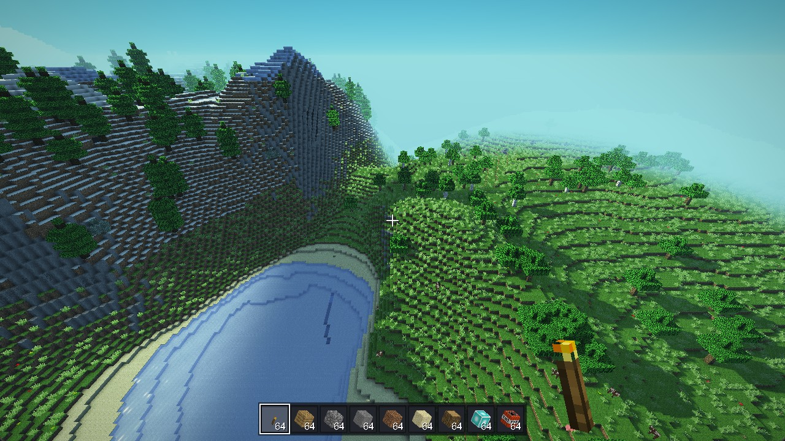
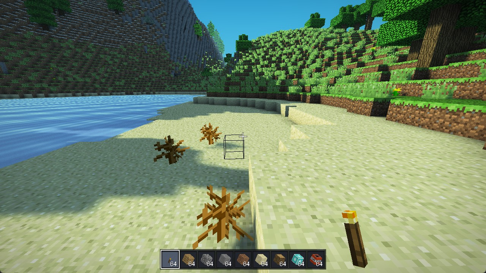
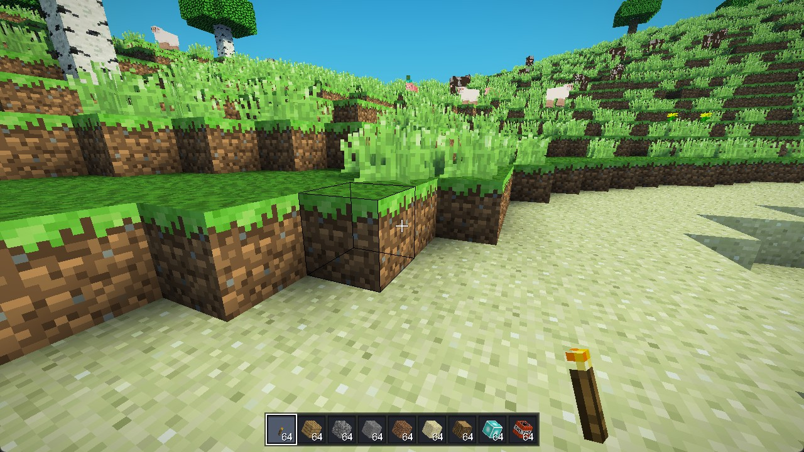
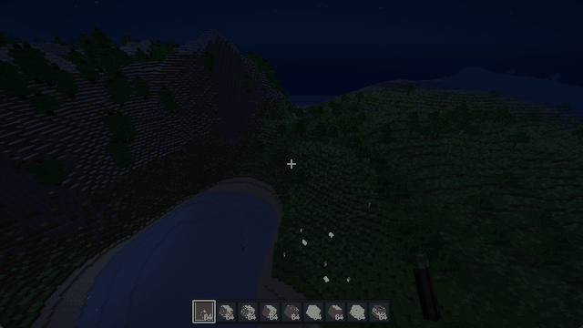

# Minecraft

[](https://github.com/HilthonTT/Minecraft/actions/workflows/ci.yml)
[](https://github.com/HilthonTT/Minecraft/actions/workflows/codeql.yml)
[](https://dotnet.microsoft.com/download)
[](LICENSE)

A voxel game engine written in C# with OpenGL and GLSL, built on [OpenTK](https://opentk.net/).



- **Infinite terrain** across ten biomes: oceans and winding rivers, snowy ridged mountains, mesas, marshes,
  caves, ravines with springs, buried ore and villages
- **Lighting**: coloured block light, smooth ambient occlusion, a day/night cycle, and optional
  [realistic shaders](#realistic-shaders) with sun shadows, swaying plants and reflective water
- **Survival and creative**: health and hunger, mobs, crafting, smelting, farming, tools that wear out
- **Multiplayer**: singleplayer runs through the same client/server code a hosted or dedicated server uses

<table>
  <tr>
    <td></td>
    <td></td>
  </tr>
</table>

## Download

Every tagged version is on the [Releases](https://github.com/HilthonTT/Minecraft/releases) page for 64-bit
Windows. `…-win-x64-self-contained.zip` runs as it is; `…-win-x64.zip` is much smaller and needs the
[.NET 10 desktop runtime](https://dotnet.microsoft.com/download/dotnet/10.0). Unzip anywhere and run
`Minecraft.App.exe`. `SHA256SUMS.txt` holds the checksums.

## Building

Needs the [.NET 10 SDK](https://dotnet.microsoft.com/download), Windows (texture loading uses
`System.Drawing`), and a GPU with OpenGL 4.0.

```sh
dotnet build
dotnet run --project src/Minecraft.App
dotnet test
```

The tests cover everything that needs neither a window nor a GPU. In Visual Studio, the `Singleplayer`,
`Dedicated server` and `Client (connect to localhost)` launch profiles skip the menu.

## Controls

| Input | Action | Input | Action |
| --- | --- | --- | --- |
| `W` `A` `S` `D` | Move | `E` | Inventory |
| Mouse | Look | `1`–`9`, scroll | Pick a hotbar slot |
| `Space` | Jump, swim, fly up | Left click | Hit, or hold to break a block |
| `Space` twice | Toggle flying (creative) | Right click | Place, use, open; hold to eat |
| `Shift` | Crouch, fly down | Middle click | Pick the block in view |
| `Ctrl` | Sprint | `Q`, `Ctrl` + `Q` | Throw one, or the whole stack |
| `Enter` | Chat | `F5` | First person, behind, facing you |
| `Escape` | Pause menu | `F1`–`F10` | Debug tools |

Every menu also works from the keyboard. `/gamemode survival` and `/gamemode creative` (or `/gm s`, `/gm c`)
switch modes from the chat. **[GAMEPLAY.md](GAMEPLAY.md)** covers the rest: menus, survival and creative, food,
farming, crafting recipes, tools, building and the debug keys.

## Start arguments

Every argument is optional.

| Argument | Values | Default | Purpose |
| --- | --- | --- | --- |
| `mode` | `client`, `server`, `clientserver` | `clientserver` | `clientserver` is singleplayer |
| `ip` | Host to connect to | `127.0.0.1` | A server always listens on every one |
| `port` | `1`–`65535` | `25565` | |
| `world` | Save directory name | `world` | Which world to load or create |
| `seed` | Any whole number | random | Only used when creating a world |
| `gamemode` | `survival`, `creative` | `survival` | Only used when creating a world |
| `menu` | `true`, `false` | `true` | `false` skips the main menu |
| `fresh` | `true`, `false` | `false` | Deletes `world` first, then regenerates |
| `loglevel` | `packet`, `info`, `warn`, `error` | `error` | `packet` traces network traffic |

```sh
dotnet run --project src/Minecraft.App -- mode=server port=25565 loglevel=info
dotnet run --project src/Minecraft.App -- world=canyons seed=12345 gamemode=creative
```

A game started from the menu takes its world, seed and mode from the menu instead, and never deletes anything.

## Options

Render distance (2–16 chunks), field of view, shaders, GUI scale, an FPS readout, volume and mouse sensitivity.
Every change applies immediately and is saved to `options.txt` beside your worlds.

### Realistic shaders

`Shaders` switches between the original look and a realistic one without a restart. The world is lit from
wherever the sun or moon is, warm at sunrise and sunset and a dim blue at night, with soft shadows over the
nearest 160 or so blocks. Leaves and plants sway, water ripples and reflects the sky, and the sky gets a sun
disc, a moon and stars. It asks more of the GPU, so weigh it against your render distance.



## Saved worlds

Worlds and `options.txt` live in `%APPDATA%\MinecraftClone`, so a new version unzipped elsewhere finds them. A
game folder that already holds `saves`, `options.txt` or an empty `portable.txt` keeps everything beside the
executable instead, and `MINECRAFT_CLONE_DATA` overrides both. Worlds save every 60 seconds and on a clean exit.
Only modified chunks are stored; the rest regenerates from the seed. See [DESIGN.md](DESIGN.md#saved-worlds).

## Project layout

| Project | Purpose |
| --- | --- |
| `Minecraft.Core` | Engine library |
| `Minecraft.App` | Executable entry point |
| `Minecraft.Tests` | Tests that need neither a window nor a GPU |

**[DESIGN.md](DESIGN.md)** explains how it all works: terrain generation, lighting, meshing, networking, the
save format and the sound engine.

## Contributing and releases

See [CONTRIBUTING.md](CONTRIBUTING.md), and read [DESIGN.md](DESIGN.md) first if you are touching world
generation. Pushing a tag such as `v0.2.0` builds, tests and publishes a release with notes from
[CHANGELOG.md](CHANGELOG.md); [CONTRIBUTING.md](CONTRIBUTING.md#cutting-a-release) has the steps.

## Credits

Based on [Ladadoos/3D-Voxel-Game-Engine](https://github.com/Ladadoos/3D-Voxel-Game-Engine/tree/master) and
[Minecraft](https://www.minecraft.net/en-us).

## License

MIT — see [LICENSE](LICENSE).
